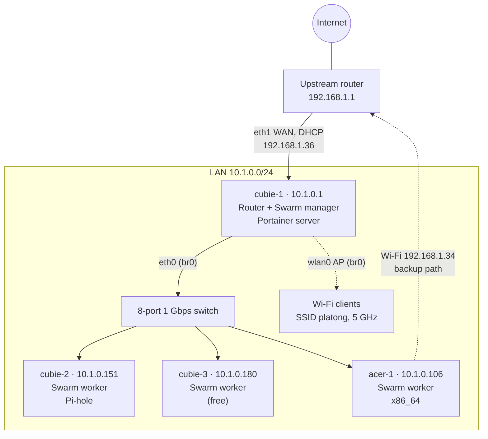

# myCluster

A portable "network-in-a-box" homelab: three Radxa Cubie A5E boards (arm64) and an Acer Veriton PC (x86_64) behind their own router, run as one Docker Swarm.

Plug cubie-1's WAN port into any upstream network and everything comes up with the same internal addresses, its own DHCP, ad-filtered DNS and a 5 GHz Wi-Fi network.

> This describes the setup as of **2026-11-22**. The [changelog](docs/changelog.md) explains how it got here.

## Topology

## Nodes

| Host | LAN IP | Hardware | OS | Swarm role | Runs |
|---|---|---|---|---|---|
| **cubie-1** | 10.1.0.1 | Radxa Cubie A5E, arm64, 1 GB RAM | Debian 13 | Manager (leader) | Router (NAT, DHCP, DNS forwarder, firewall, Wi-Fi AP, traffic shaping), Portainer server |
| **cubie-2** | 10.1.0.151 | Radxa Cubie A5E, arm64, 1 GB RAM | Debian 13 | Worker | Pi-hole |
| **cubie-3** | 10.1.0.180 | Radxa Cubie A5E, arm64, 1 GB RAM | Debian 13 | Worker | Free for apps |
| **acer-1** | 10.1.0.106 | Acer Veriton, Core i5-6400T, x86_64, 23 GB RAM | Ubuntu 26.10 | Worker | Free for apps (the main capacity) |

Every node also runs a Portainer agent.

## Quick reference

| | |
|---|---|
| LAN | `10.1.0.0/24`, gateway `10.1.0.1`, DHCP pool `10.1.0.100`–`10.1.0.200` |
| WAN | cubie-1 `eth1`, DHCP from the upstream router |
| Wi-Fi | SSID `platong`, 5 GHz channel 44, 80 MHz, WPA2 |
| DNS | Every LAN query is filtered by Pi-hole; `1.1.1.1` takes over if Pi-hole is down |
| Portainer | <https://10.1.0.1:9443> (self-signed certificate) |
| Pi-hole | <http://10.1.0.151/admin> |
| SSH | `ssh radxa@cubie-1.local` (also `cubie-2`, `cubie-3`) and `ssh veriton@acer-1.local` |

Passwords, the Wi-Fi passphrase and tokens are deliberately not stored in this repository.

## Documentation

| Page | What's in it |
|---|---|
| [Architecture](docs/architecture.md) | Roles, IP plan, how traffic and DNS flow, design decisions |
| [Router](docs/router.md) | cubie-1's network, Wi-Fi, DHCP/DNS, firewall and traffic-shaping config |
| [Nodes](docs/nodes.md) | Hardware, OS and the slimmed-down base system on each machine |
| [Services](docs/services.md) | Docker Swarm, the Portainer and Pi-hole stacks, deploying apps |
| [Operations](docs/operations.md) | Access, health checks, updates, reboots, routine tasks |
| [Disaster recovery](docs/disaster-recovery.md) | What's backed up, rebuild order, replacing a node |
| [Troubleshooting](docs/troubleshooting.md) | Problems already hit, with causes and fixes |
| [Changelog](docs/changelog.md) | What changed and when |

## Known gaps

- SSH still accepts password logins; SSH keys aren't set up yet.
- cubie-1 is both the router and the only Swarm manager. While it's down there is no LAN, and the swarm can't be managed (containers on the other nodes keep running).
- acer-1 has no DHCP reservation, so `10.1.0.106` is an ordinary lease.
- The Portainer and Pi-hole data volumes aren't backed up.
- acer-1 keeps a second default route over its Wi-Fi, so some of its traffic can bypass cubie-1 and Pi-hole.
- An unused USB Wi-Fi dongle is still plugged into cubie-1 (its driver is blocked); it can be unplugged.

## License

[Apache License 2.0](LICENSE)
