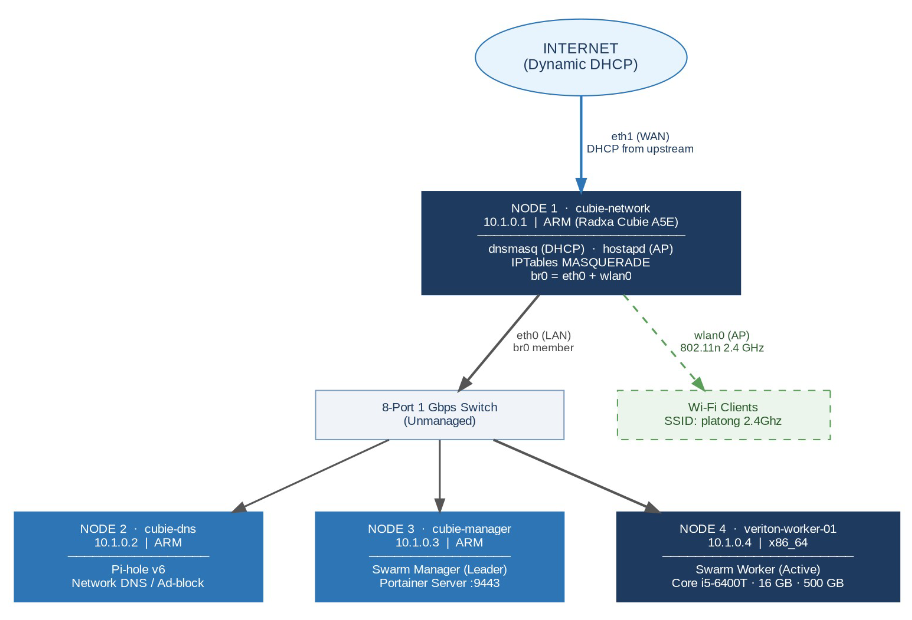

# Portable Hybrid-Arch Docker Swarm Cluster

A self-contained, portable "network-in-a-box" cluster built with ARM SBCs and an x86 worker.

## Features
- Hybrid ARM + x86 architecture
- Built-in DHCP, DNS, and Wi-Fi AP
- Docker Swarm orchestration
- Pi-hole network-wide ad blocking
- Fully portable setup

## Architecture

## Documentation Website

This repository now includes a docs website structure under `/docs` with MkDocs navigation in `mkdocs.yml`.

- Main page: `docs/index.md`
- Full sections: overview, architecture, operations, and disaster recovery

To preview locally:

1. Install MkDocs: `pip install mkdocs`
2. Run: `mkdocs serve`
3. Open: `http://127.0.0.1:8000`
