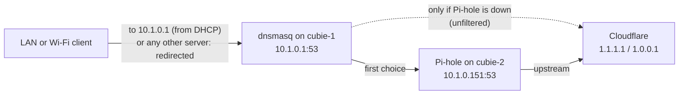

# Architecture

## Roles

| Node | Role | Notes |
|---|---|---|
| cubie-1 | Router, the only Swarm manager, Portainer server | The whole LAN depends on it, so cluster management is available whenever the network is |
| cubie-2 | Swarm worker running Pi-hole | DNS filtering stays off the router; if it fails, DNS falls back to Cloudflare |
| cubie-3 | Swarm worker | Spare arm64 capacity |
| acer-1 | Swarm worker | 23 GB RAM and x86_64: the place for heavy or amd64-only apps |

## Physical layout

- cubie-1 `eth1` → upstream router (WAN).
- cubie-1 `eth0` → 8-port 1 Gbps unmanaged switch.
- cubie-2 and cubie-3 (`eth1`) and acer-1 (`enp1s0f0`) → switch.
- Wi-Fi clients → cubie-1's onboard Wi-Fi (`wlan0`).
- cubie-1 bridges `eth0` and `wlan0` into `br0`, so wired and Wi-Fi devices share one LAN.
- acer-1's own Wi-Fi (`wlp2s0`) joins the upstream network, which gives a second way into the LAN when cubie-1's Wi-Fi is down.

## IP plan

| Address | Used by | Assigned |
|---|---|---|
| 10.1.0.1 | cubie-1 (`br0`) | Static |
| 10.1.0.100 – 10.1.0.200 | DHCP pool, 24 h leases | dnsmasq on cubie-1 |
| 10.1.0.151 | cubie-2 | DHCP reservation by MAC |
| 10.1.0.180 | cubie-3 | DHCP reservation by MAC |
| 10.1.0.106 | acer-1, wired | Ordinary DHCP lease |
| 192.168.1.36 | cubie-1 WAN (`eth1`) | DHCP from the upstream router (192.168.1.1) |
| 192.168.1.34 | acer-1 Wi-Fi (`wlp2s0`) | DHCP from the upstream router |

IPv6 is disabled on cubie-1. Hostnames resolve as `<host>.local` over mDNS (avahi on the cubies, systemd-resolved on acer-1).

## Traffic

### To the internet

LAN devices route through cubie-1: the firewall allows `br0` → `eth1`, NAT masquerades on `eth1`, and SQM shapes the link to 85 Mbit in each direction.

### From outside

Nothing on the WAN side can reach the LAN or any container. On `eth1`, cubie-1 itself only answers ping; SSH, Portainer and Pi-hole are LAN-only.

### DNS

1. DHCP gives every client `10.1.0.1` as its only DNS server.
2. dnsmasq on cubie-1 asks Pi-hole first and uses `1.1.1.1` only when Pi-hole doesn't answer. It passes each client's IP and MAC along, so Pi-hole's statistics show the real devices.
3. A device that hard-codes another DNS server (8.8.8.8, 1.1.1.1 and so on) on port 53 is redirected to cubie-1 by nftables.
4. Pi-hole (10.1.0.151) is exempt from the redirect and uses `1.1.1.1` and `1.0.0.1` as its upstream.
5. Encrypted DNS is curbed: DNS-over-TLS and DNS-over-QUIC (port 853) are rejected, and Pi-hole blocks known DNS-over-HTTPS servers. VPNs aren't blocked, so a VPN still bypasses Pi-hole.
6. cubie-1 resolves its own lookups through `1.1.1.1` and `1.0.0.1` directly, so the router keeps working without cubie-2.

Config details: [router.md](router.md#dhcp-and-dns).

## Swarm layout

| Service | Mode | Runs on | Published |
|---|---|---|---|
| `portainer_portainer` | 1 replica | Manager (cubie-1) | 9443/tcp through the routing mesh |
| `portainer_agent` | Global | Every node | Overlay network only |
| `pihole_pihole` | 1 replica | cubie-2 | 53/tcp, 53/udp, 80/tcp in host mode |

Config details: [services.md](services.md).

## Design decisions

| Decision | Why | Cost |
|---|---|---|
| Docker Swarm instead of Kubernetes | Docker with Swarm needs roughly 80–120 MB of RAM; even a trimmed K3s control plane needs about 300–400 MB (both estimates), a big share of a cubie's ~900 MB | No Helm or Kubernetes tooling |
| cubie-1 is the only manager | The router has to be up for anything to work, so management never depends on acer-1 being switched on | One box is a single point of failure for both the network and the swarm, and its apps share RAM with the router |
| Pi-hole pinned to cubie-2 with host-mode ports | Pi-hole sees where queries really come from, and the router stays light | Pi-hole can't move if cubie-2 dies; DNS falls back to Cloudflare until it's back |
| DNS forwarded by the router with a fallback | A Pi-hole outage means unfiltered DNS instead of no DNS | Ads aren't blocked during an outage |
| Forced DNS and blocked encrypted DNS | Devices with hard-coded DNS are still filtered | iCloud Private Relay shows a warning on this network; DNS apps such as Cloudflare WARP may not connect |
| Stripped-down base systems | Desktop leftovers were most of the RAM use and boot time | Using a removed feature means reinstalling packages |
| No Swarm task history | Portainer shows only live tasks, and nothing piles up | A crashed task can't be inspected after it's replaced |
