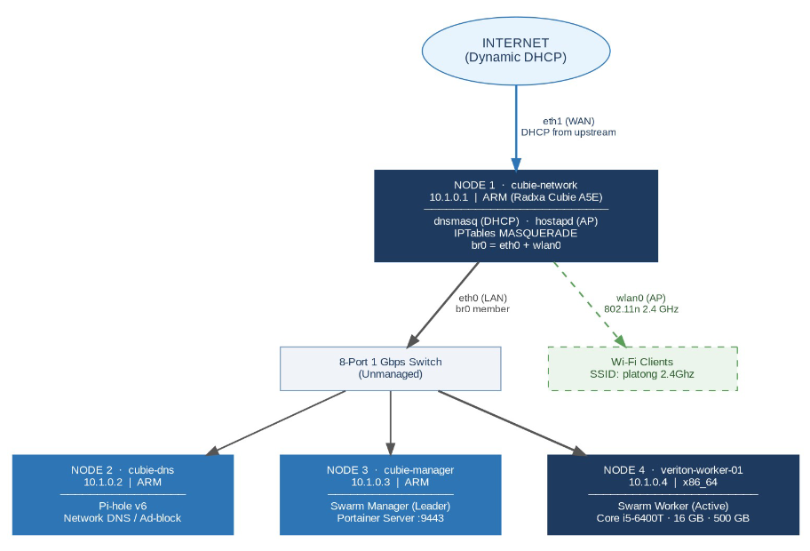

# Portable Hybrid-Arch Docker Swarm Cluster

This documentation site describes a portable **Network-in-a-Box** cluster built from:

- 3x ARM nodes (Radxa Cubie A5E)
- 1x x86_64 worker node (Acer Veriton)
- Docker Swarm orchestration
- Built-in DHCP, DNS, Wi-Fi AP, and Pi-hole

## Quick Facts

| Property | Value |
|---|---|
| Architecture | Hybrid (ARM + x86_64) |
| Subnet | `10.1.0.0/24` |
| Nodes | 4 total |
| Swarm | Docker Engine 29.3 |
| Dashboard | Portainer CE |
| DNS / Ad-block | Pi-hole |
| Wi-Fi SSID | `platong 2.4Ghz` |

## Topology

## Documentation Sections

- **Project Overview**: goals, use cases, and design principles
- **Architecture**: node roles, network model, and service placement
- **Operations**: startup, health checks, and routine management
- **Disaster Recovery**: node replacement and rebuild guidance
